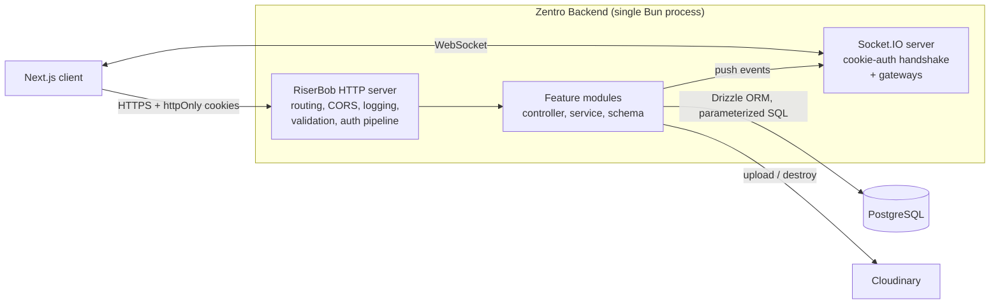
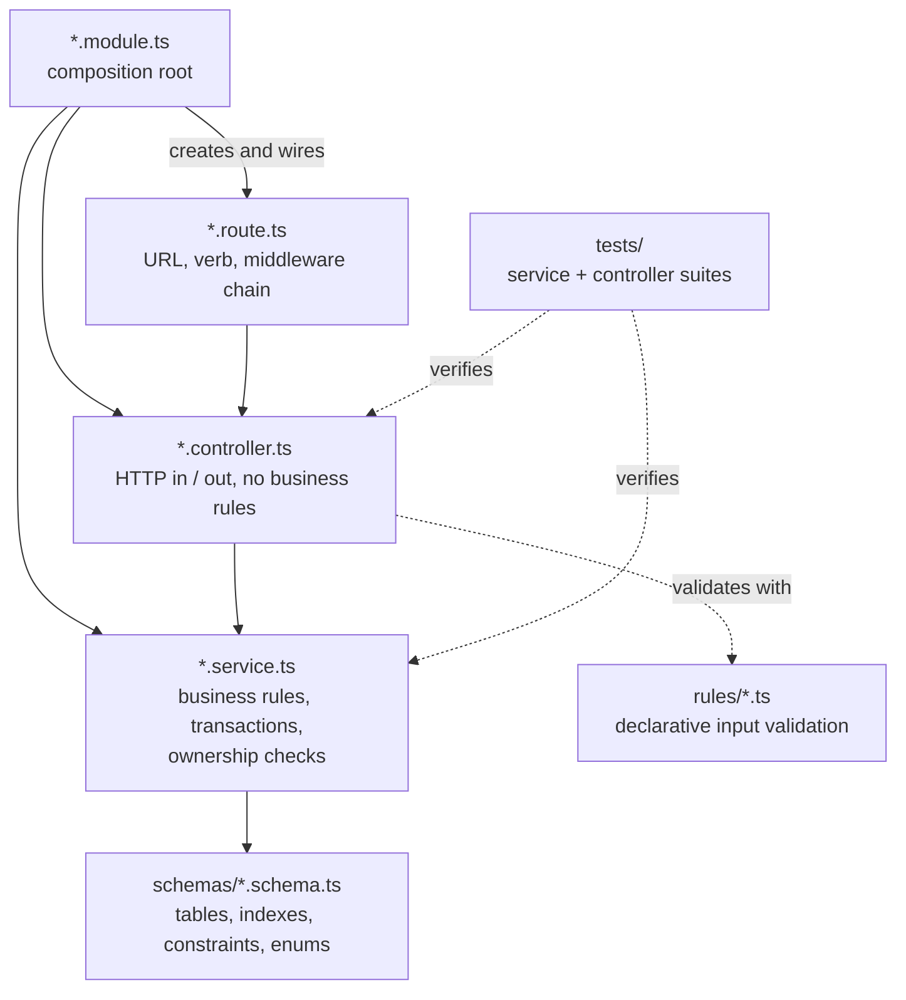
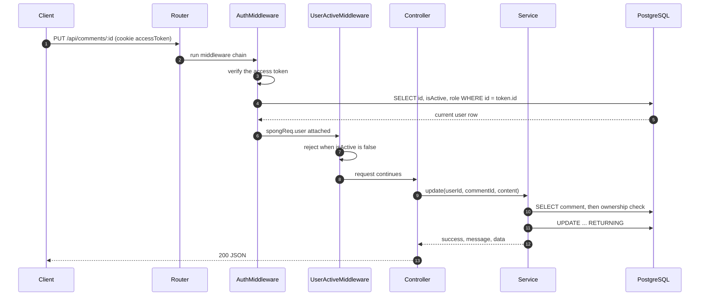
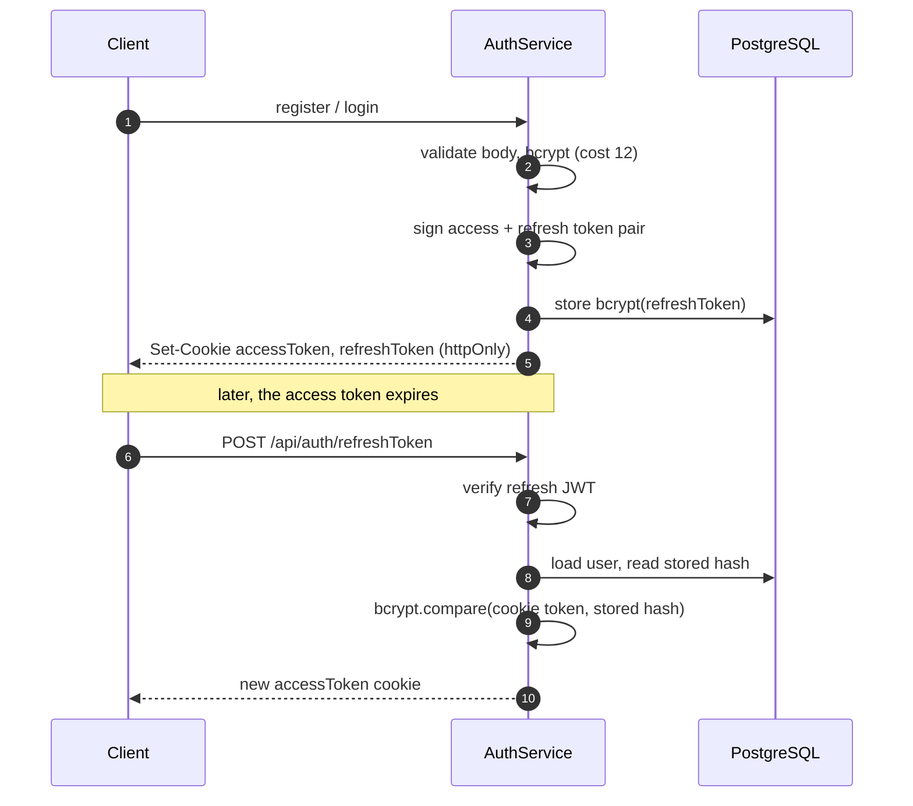
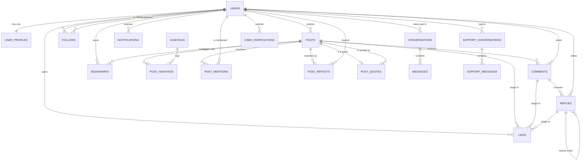
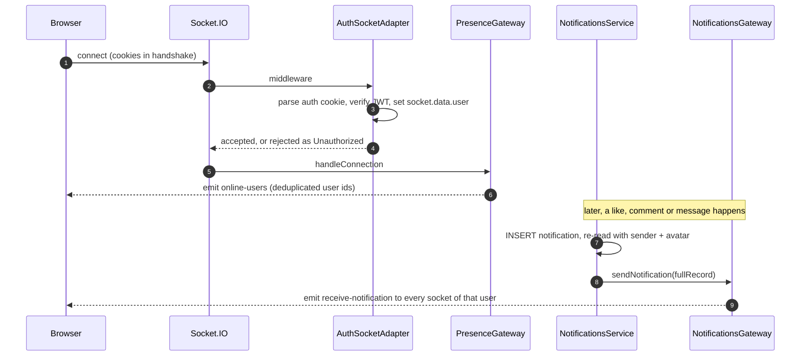
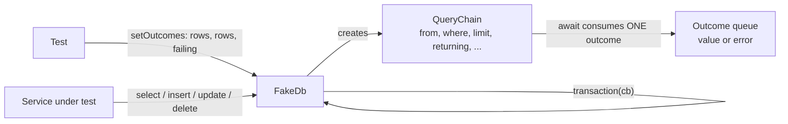

<div align="center">

# Zentro — Social Network Backend

**A Threads-style social platform API, engineered for consistency, real-time delivery, and provable correctness.**

[](https://bun.sh)
[](https://www.typescriptlang.org/)
[](https://orm.drizzle.team)
[](https://socket.io)
[](#-testing-strategy)
[](https://github.com/ZenZN99/RiserBob)

</div>

<p align="center">
  
</p>

## Project Overview

Zentro is the backend of a Threads-like social network: posts with images, hashtags, mentions, quotes and reposts, threaded comments and replies, follows, likes, bookmarks, direct messages, live notifications, online presence, identity verification and a support desk.
It runs on **Bun + TypeScript + PostgreSQL**, is built on **[RiserBob](https://github.com/ZenZN99/RiserBob)**, a framework I wrote from scratch, and is protected by **1,219 automated tests**.


---

## Table of Contents

- [Getting Started](#-getting-started)
- [Architecture](#-architecture)
- [Testing Strategy](#-testing-strategy)
- [Problems I Faced and How I Solved Them](#-problems-i-faced-and-how-i-solved-them)
- [Built on RiserBob](#-built-on-riserbob)
- [Known Trade-offs and Roadmap](#-known-trade-offs-and-roadmap)
- [Repository Layout](#-repository-layout)

---

## 🚀 Getting Started

### Prerequisites

| Tool | Version | Notes |
| --- | --- | --- |
| [Bun](https://bun.sh) | 1.3+ (developed on 1.4) | Runtime, package manager and test runner |
| PostgreSQL | 14+ | Any reachable instance, local or hosted |
| [Cloudinary](https://cloudinary.com) account | free tier is enough | Image and file uploads |

### 1. Clone and install

```bash
git clone github.com/ZenZN99/Zentro-Social-Media-App zentro
cd zentro/backend
bun install
```

### 2. Configure the environment

```bash
cp .env.example .env
```

| Variable | Required | Description |
| --- | :---: | --- |
| `DB_HOST` | ✅ | PostgreSQL host (defaults to `localhost`) |
| `DB_PORT` | ✅ | PostgreSQL port (defaults to `5432`) |
| `DB_NAME` | ✅ | Database name, e.g. `zentro` |
| `DB_USERNAME` | ✅ | Database user |
| `DB_PASSWORD` | ✅ | Database password |
| `DB_SSL` | optional | Set to `true` for hosted databases that require TLS |
| `JWT_ACCESS_SECRET` | ✅ | Signs access tokens. Use 32+ random characters |
| `JWT_REFRESH_SECRET` | ✅ | Signs refresh tokens. **Must differ** from the access secret |
| `JWT_ISSUER` | ✅ | Token issuer, e.g. `zentro-api` |
| `JWT_AUDIENCE` | ✅ | Token audience, e.g. `zentro-client` |
| `CLOUDINARY_CLOUD_NAME` | ✅ | Cloudinary cloud name |
| `CLOUDINARY_API_KEY` | ✅ | Cloudinary API key |
| `CLOUDINARY_API_SECRET` | ✅ | Cloudinary API secret |

Generate strong secrets with:

```bash
bun -e "console.log(crypto.randomUUID() + crypto.randomUUID())"
```

> The API listens on port **4000** and allows CORS from the frontend origin in `src/url.ts` (`http://localhost:3000` by default). Change that constant for your deployment.

### 3. Create the database schema

The schema lives in code (`src/modules/**/schemas/*.schema.ts`, 19 tables). Create the database, then let [drizzle-kit](https://orm.drizzle.team/docs/kit-overview) materialize it.

```bash
createdb zentro                       # or create it from your SQL client
bun add pg                            # PostgreSQL driver used by src/config/db/drizzle.ts
bun add -d drizzle-kit
```

Create `drizzle.config.ts` in the `backend/` folder:

```ts
import { defineConfig } from 'drizzle-kit'

export default defineConfig({
  dialect: 'postgresql',
  schema: './src/modules/**/schemas/*.schema.ts',
  out: './drizzle',
  dbCredentials: {
    host: process.env.DB_HOST || 'localhost',
    port: Number(process.env.DB_PORT || 5432),
    database: process.env.DB_NAME!,
    user: process.env.DB_USERNAME!,
    password: process.env.DB_PASSWORD!,
    ssl: process.env.DB_SSL === 'true',
  },
})
```

Then push the schema:

```bash
bunx drizzle-kit push
```

### 4. Run the server

```bash
bun run dev
```

```text
Database connected successfully.
🧽 RiserBob is running at http://localhost:4000 🍍
```

Check it:

```bash
curl http://localhost:4000/
# {"message":"Welcome to Bikini Bottom! 🍍"}
```

### 5. Promote your first admin

New accounts are always created with the `user` role. Register once, then promote the account in SQL. After that, admins can change roles through the API.

```sql
UPDATE users SET role = 'admin' WHERE email = 'you@example.com';
```

### Everyday commands

| Command | What it does |
| --- | --- |
| `bun run dev` | Start with hot reload (`bun run --watch src/launch.ts`) |
| `bun test` | Run the full suite (1,219 tests) |
| `bun test src/modules/comments/tests/comments.service.test.ts` | Run a single file |
| `bun run typecheck` | Strict TypeScript check (`tsc --noEmit`) |
| `bun run src/launch.ts` | Production start (Bun executes TypeScript directly) |
| `bun build src/launch.ts --outdir dist --target bun --minify` | Optional single-file bundle, run with `bun dist/launch.js` |

---

## 🏛 Architecture

Zentro is a **modular monolith**: one deployable process, 15 top-level feature modules (plus 5 post sub-modules), strict one-way dependencies, and every collaborator injected through a constructor. There is no hidden global state in the business layer, which is what makes 1,219 fast, deterministic tests possible.

### 1. System context



### 2. Module anatomy

Every feature follows the same four-layer shape. The composition root is the module class, the only place where concrete dependencies are created and wired.



| Layer | Owns | Must never |
| --- | --- | --- |
| **Controller** | Parse the request, read `spongReq.user`, call exactly one service method, shape the response | Contain business logic or touch the database |
| **Service** | Business rules, ownership and permission checks, transaction boundaries, counters, notifications | Know about HTTP details such as cookies or headers (the auth module is the single deliberate exception) |
| **Schema** | Tables, foreign keys, cascade rules, unique and secondary indexes, enums | Hold behavior |
| **Module** | Dependency wiring (`new Service(database, …)`) | Contain logic |

Services receive the database as `typeof database` through their constructor, so tests inject a fake and production injects the Drizzle client. The pagination helper, sanitizer and username generator live in `src/utilities/` and are reused by every module.

### 3. Request lifecycle

Authentication is not trusted from the token alone. The token proves *who*, then the database proves *that they still exist and are still allowed in*.



Two consequences worth calling out:

- **Blocking takes effect on the very next request.** `isActive` and `role` are read from PostgreSQL on every authenticated call, never trusted from a token minted earlier.
- **Role-based routes compose, they do not branch.** `ProtectedMiddleware` builds a pipeline (`auth → active → role`) and exposes `auth()`, `admin()` and `adminAndSupport()`.

### 4. Authentication and session design



| Decision | Reason |
| --- | --- |
| Tokens travel in **httpOnly cookies** | JavaScript on the page can never read them, which removes the most common XSS token-theft path |
| Refresh token is stored **hashed (bcrypt)** | A database leak does not leak usable sessions |
| Separate secrets for access and refresh tokens | Compromise of one does not forge the other |
| Tokens are bound to an issuer and an audience | Tokens minted for another service or client are not meant to be accepted here |
| `sanitizeUser()` strips `password` and `refreshToken` | No response can leak credentials by accident |
| Duplicate registration returns a generic message | Prevents account enumeration |
| Wrong email and wrong password share one message | Same reason |

### 5. Data architecture

19 tables, UUID primary keys, cascade rules on every ownership edge.



Design choices that matter:

- **Denormalized counters, protected by transactions.** `likesCount`, `commentsCount`, `repliesCount`, `followersCount`, `postsCount` and friends are stored on the row, so a feed page is a single indexed read instead of a pile of `COUNT(*)` subqueries. Counters are always changed with relative SQL (`col + 1`, `col - n`), never read-modify-write, and always inside the same transaction as the row that justifies them.
- **Uniqueness is enforced by the database, not by hope.** Composite unique indexes guard follows, likes (per target type), bookmarks, reposts, mentions and post-hashtag links. Even two simultaneous requests cannot create a duplicate.
- **Polymorphic likes without a polymorphic foreign key.** A like carries one nullable foreign key per target (`postId`, `commentId`, `replyId`), each with its own unique index and cascade rule, so referential integrity is real.
- **Indexes follow the queries.** `posts(authorId, createdAt)`, `comments(postId, createdAt)`, `hashtags(postsCount)`, `notifications(receiverId)` and others exist because a service query sorts or filters on exactly those columns.
- **Hashtag creation is race-safe.** `findOrCreate` uses `ON CONFLICT DO NOTHING` on the unique name, then re-reads.

### 6. Consistency model: what is atomic and what is best-effort

The central rule: **the primary action and its counters commit together or not at all; notifications and socket pushes are side effects layered on top and never roll the primary action back.** For likes, comments and follows they are additionally isolated with `try/catch`, so a notification failure is invisible to the user.

| Operation | Atomic unit (one DB transaction) | Side effects |
| --- | --- | --- |
| Create comment | post exists → insert comment → `post.commentsCount + 1` → `profile.commentsCount + 1` | Notification to post owner (failure swallowed) |
| Delete comment | ownership → find replies → delete replies → decrement each replier's `repliesCount` → delete comment → decrement post and owner counters | none |
| Create reply | comment exists → optional parent reply must belong to the same comment → insert → `comment.repliesCount + 1` → `post.commentsCount + 1` → `profile.repliesCount + 1` | Notification to the comment owner |
| Follow / unfollow | target exists → insert or delete edge → both users' follower and following counters | Notification on follow only |
| Create post | quoted post exists → mentions validated → insert post → `postsCount + 1` → hashtags find-or-create, attach, increment → mentions → quote link and `quotesCount` | Follower fan-out notifications |
| Send message | find-or-create conversation → update `lastMessage` → insert message → re-read hydrated row | Notification (skipped when the conversation is muted) and real-time push |
| Toggle like | target exists → insert or delete like → counter | Notification on first like and every 25th |

Images are uploaded **before** the transaction. If anything fails afterwards, a compensating step destroys the uploaded files (`Promise.allSettled`), so a failed request does not leave orphaned media behind.

### 7. Real-time layer



| Event (server → client) | Emitted by | Payload |
| --- | --- | --- |
| `online-users` | `PresenceGateway` | Deduplicated array of online user ids, broadcast on every connect and disconnect |
| `receive-notification` | `NotificationsGateway` | The full notification record including `sender` and avatar |
| `notification-read` | `NotificationsGateway` | `{ notificationId }` |
| `notifications-marked-as-read` | `NotificationsGateway` | none |
| `receive-message` | `MessagesGateway` | The new message |
| `message-deleted` | `MessagesGateway` | `{ messageId }` |

- **Multi-device by design.** Each gateway tracks `(userId, socketId)` pairs, so one user can be online on a phone and a laptop and receives events on both. Presence counts a user once.
- **No gateway cycles.** `NotificationsService` depends on `NotificationsGateway`, so the gateway is deliberately forbidden from depending on the service. Inbound socket events (mark as read) live in a separate `NotificationSocketGateway`.
- **The socket is authenticated before it exists.** A connection with no valid cookie is rejected during the handshake and never reaches any gateway.

### 8. Feed visibility model

Posts carry a `visibility` of `public`, `followers` or `private`. The feed query resolves visibility **inside one SQL statement** with a conditional left join on `follows`:

| Viewer | Sees |
| --- | --- |
| Anyone | `public` posts |
| Authenticated user | `public` + own posts of any visibility + `followers` posts from authors they follow |

Total counts reuse the same predicate, so pagination metadata can never disagree with the rows shown. Pagination is capped (`limit ≤ 100`, `page ≥ 1`) in one shared helper and returns `total`, `totalPages`, `hasNextPage` and `hasPreviousPage`.

### 9. Security model

| Concern | Mechanism |
| --- | --- |
| Authentication | JWT (HS256) in httpOnly cookies, verified against the database each request |
| Authorization | Role pipeline: `user`, `support`, `admin`. Ownership is enforced in services, never trusted from the request body |
| Input validation | Declarative `rules/*.ts` schemas for every endpoint that accepts structured input, returning `422` with field errors |
| SQL injection | Drizzle builders and `sql` template parameters only. There is no string concatenation into SQL, and the test suite asserts that injection-looking ids are passed as bound parameters |
| Prototype-key abuse | Polymorphic targets are resolved with `Object.hasOwn`, so inputs like `constructor` are rejected as an invalid target type |
| Secrets | Environment variables only. `.env` is git-ignored and `.env.example` ships with placeholders |
| Credential leakage | `sanitizeUser()` on every user payload, bcrypt cost 12 |
| Account lifecycle | Admins can block a user. The block applies on the next request and the user is notified |

### 10. Failure-mode matrix

| What fails | What the user experiences | What the system guarantees |
| --- | --- | --- |
| Notification creation | Their like, comment or follow still succeeds | No rollback of the primary action |
| Cloudinary upload (mid-batch) | Clear error | Already-uploaded files are destroyed |
| Any statement inside a transaction | Error response | Row and counters roll back together |
| Concurrent duplicate like or follow | One wins | Unique index rejects the second |
| Recipient offline | Nothing is lost | Notification is persisted, the socket push is skipped |
| Socket without a valid cookie | Handshake rejected | Never reaches a gateway |
| Blocked account with a still-valid token | `403` on the next request | `isActive` is read from the database |

### 11. API surface

73 route registrations across 16 resource groups. Protected routes run `auth → active`; admin routes add the role gate.

| Group | Prefix | Highlights |
| --- | --- | --- |
| Auth | `/api/auth` | `register`, `login`, `refreshToken`, `logout`, `me` |
| Users | `/api/users` | list, get by username. Admin: `PATCH /:userId` (role), `DELETE /:userId` (block) |
| Profiles | `/api/user-profiles` | `PUT` avatar, cover, bio, socials, privacy |
| Posts | `/api/posts` | feed, by id, by user, `me`, create, update, delete |
| Hashtags | `/api/hashtags` | trending (ordered by `postsCount`, then name) |
| Reposts | `/api/reposts` | repost, `me`, by user |
| Comments | `/api/comments` | list by post, get, `me`, create, update, delete |
| Replies | `/api/replies` | nested threads under a comment |
| Likes | `/api/likes` | toggle, list, count and `is-liked` for `post`, `comment` or `reply` |
| Follows | `/api/follows` | toggle, followers, following, counts, `is-following` |
| Bookmarks | `/api/bookmarks` | toggle, `me`, counts |
| Conversations | `/api/conversations` | `me`, get, mute |
| Messages | `/api/messages` | send (with up to 5 attachments), list, mark read, unread count, delete |
| Notifications | `/api/notifications` | `me`, mark one or all as read, delete |
| Verifications | `/api/user-verifications` | submit documents. Admin: pending queue and approve or reject |
| Support | `/api/support-conversations`, `/api/support-messages` | tickets and messages. Admin and support staff see the queue, admins open or close tickets |

> Note on the current auth routes: `register` and `login` are registered with the `GET` verb in `src/modules/auth/auth.route.ts`, exactly as listed above in the code.

---

## 🧪 Testing Strategy

<div align="center">

| Test cases | Assertions | Test files | Failures | Wall time |
| :---: | :---: | :---: | :---: | :---: |
| **1,219** | **2,680** | **35** | **0** | **≈ 0.55 s** |

</div>

The suite contains **23,000+ lines of test code for ~10,000 lines of production code**, so there are more than twice as many lines verifying behavior as there are implementing it. It needs no database, no network and no Cloudinary account, which is why the entire thing runs in about half a second.

```bash
bun test
```

```text
 1219 pass
 0 fail
 2680 expect() calls
Ran 1219 tests across 35 files.
```

### Test architecture: a fake database that behaves like Drizzle

Mocking an ORM usually means mocking return values and hoping the call order is right. Zentro instead ships a tiny, honest simulator of the Drizzle query builder.



- `QueryChain` is a **thenable**. Every builder method (`from`, `where`, `leftJoin`, `orderBy`, `limit`, `offset`, `values`, `set`, `returning`) returns the same chain, and `await`-ing it pops exactly one pre-programmed outcome.
- An outcome is either rows or an error, so database failures are simulated in one line.
- `transaction()` runs its callback against the same fake, so transactional code paths execute for real.

The consequence is subtle and powerful: **a test encodes the exact sequence of queries the service must run.** If someone adds, removes or reorders a query, the suite fails loudly. The outcome list reads like an executable specification of the transaction:

```ts
db.setOutcomes([
  rows([post]),        // 1. find post
  rows([created]),     // 2. insert comment RETURNING
  rows([]),            // 3. post.commentsCount + 1
  rows([]),            // 4. profile.commentsCount + 1
  rows([user]),        // 5. load commenter (for the notification)
])
```

### What is covered

| Category | Examples of what is asserted |
| --- | --- |
| Happy paths | Exact response shape, counters updated the expected number of times, notifications built with the right payload |
| Missing resources | `404` paths, and that **no write** happened afterwards (`insert` and `update` never called) |
| Authorization | Non-owners rejected, role gates enforced, self-actions refused (follow yourself, message yourself) |
| Failure propagation | DB errors surface untouched, at every step including mid-transaction |
| Side-effect isolation | A failing notification never fails the like, comment or follow |
| Idempotency and dedupe | Duplicate hashtag ids removed, `onConflictDoNothing` honored, only truly inserted rows returned |
| Security | Injection-looking ids treated as bound parameters, never as SQL |
| Pagination | Default arguments, empty results, zero totals when the count query returns no rows |
| Controllers | Request parsing, user extraction, JSON error propagation, response mapping |

### Distribution

| Module | Tests | | Module | Tests |
| --- | ---: | --- | --- | ---: |
| posts | 120 | | user-profiles | 66 |
| messages | 99 | | notifications | 61 |
| likes | 95 | | user-verifications | 60 |
| replies | 91 | | hashtags | 57 |
| support-messages | 88 | | comments | 48 |
| post-reposts | 74 | | bookmarks | 46 |
| support-conversations | 72 | | follows | 44 |
| post-mentions | 43 | | auth | 42 |
| post-hashtags | 37 | | post-quotes | 29 |
| users | 28 | | conversations | 19 |

**789** service tests verify business rules and transactions. **430** controller tests verify the HTTP edge.

---

## 🛠 Problems I Faced and How I Solved Them

These are the real engineering problems this codebase had to survive. Each one is still visible in the source and defended by tests.

### 1. Counters that drift out of sync

**Problem.** A feed needs `likesCount`, `commentsCount`, `followersCount` and more on every row. Updating a row and its counter in separate statements means a crash between the two leaves permanent, silent lies in the data. Read-modify-write (`count = count + 1` computed in JavaScript) also loses updates under concurrency.

**Solution.** Counters are always changed with relative SQL (``sql`${col} + 1` ``) and always inside the same transaction as the row that justifies them. Deleting a comment is the hardest case: it must remove every reply and decrement the `repliesCount` of *each distinct replier*, so replies are grouped per user in a `Map` and each user is decremented once by the right amount. The test suite pins the exact query sequence, so the invariant cannot regress unnoticed.

### 2. Orphaned images when a request fails halfway

**Problem.** Uploads go to Cloudinary, outside the database transaction. If validation or a later statement fails, the files stay in the cloud forever, costing money and leaking user content.

**Solution.** Uploaded `publicId`s are tracked as they are created. Any failure triggers a compensating cleanup with `Promise.allSettled(... destroyImage)`, so one failed deletion cannot block the others, and the original error is preserved as the `cause`.

### 3. A notification must never break the action that caused it

**Problem.** Liking a post should not return an error because a notification row could not be written.

**Solution.** Like, comment and follow run the primary action first and wrap the notification in its own `try/catch`. Tests assert both halves: the action succeeds, and the notification was still attempted exactly once.

### 4. A circular dependency between the notification service and its socket gateway

**Problem.** `NotificationsService` needs a gateway to push events, and handling an inbound "mark as read" event needs the service. Wiring both ways creates a cycle.

**Solution.** The outbound gateway only pushes and is forbidden from depending on the service. Inbound events live in a separate `NotificationSocketGateway` that depends on the service. The rule is written as a comment at the top of the gateway so the next contributor does not undo it.

### 5. One user, many devices

**Problem.** Tracking presence as `userId → socketId` breaks as soon as someone opens a second tab: one disconnect marks them offline everywhere.

**Solution.** Gateways track `(userId, socketId)` pairs, deliver events to every live socket of a user, and publish presence as a deduplicated set of user ids.

### 6. Likes for three different kinds of target

**Problem.** Posts, comments and replies can all be liked. A single `targetId` column cannot carry a real foreign key, and a user-supplied `targetType` is a prototype-key trap.

**Solution.** One nullable foreign key per target with its own cascade rule and its own composite unique index, so referential integrity and "one like per user per target" are enforced by PostgreSQL. The target type is resolved through `Object.hasOwn`, so values like `constructor` are rejected as invalid instead of being looked up.

### 7. Notification spam on popular content

**Problem.** A viral post would notify its author on every single like.

**Solution.** A notification is sent for the first like and then only at milestones (every 25th like), with a message such as "Alex and 24 others liked your post".

### 8. Privacy-aware feeds without N+1 queries

**Problem.** `public`, `followers` and `private` posts must be filtered per viewer, and pagination totals must agree with the rows shown.

**Solution.** A single query left-joins `follows` and builds the visibility predicate once. The page query and the count query share it. No per-row follow lookups, and no page that disagrees with its own `total`.

### 9. Concurrent hashtag creation

**Problem.** Two users posting `#bun` at the same instant must not create two hashtags or crash on the unique index.

**Solution.** `findOrCreate` inserts with `ON CONFLICT DO NOTHING` against the unique name and then reads the winner back. Attaching tags to posts uses the same conflict strategy and reports only the rows actually inserted.

### 10. A blocked user whose token is still valid

**Problem.** A JWT remains valid until it expires, so a purely token-based check would let a blocked account keep working.

**Solution.** Authentication verifies the token and then loads `isActive` and `role` from PostgreSQL on every request. An admin block applies on the very next call.

### 11. Unique usernames at registration

**Problem.** `@johndoe` will collide eventually.

**Solution.** `generateUsername` derives a base handle, probes for existing ones and appends an incrementing suffix. A unique index remains the final authority.

### 12. Testing database code without a database

**Problem.** Mocking an ORM chain call by call is brittle. Tests pass while the real query order is wrong, or fail for reasons unrelated to the code.

**Solution.** I built the `FakeDb` and `QueryChain` simulator described above, where every awaited query consumes exactly one scripted outcome. It exposed a classic trap I hit myself: when a test scripts fewer or more outcomes than the service actually runs, the failure is `No mock outcome available` or a wrong result, and the production code is **not** the thing that is wrong. The fix is always to trace the real execution order, including queries inside transactions, conditional branches and loops. That rule is now written down in `AGENTS.md` and `CLAUDE.md` so humans and AI assistants follow it.

---

## 🧽 Built on RiserBob

Zentro runs on **[RiserBob](https://github.com/ZenZN99/RiserBob)**, a Bun and TypeScript backend framework that I designed and built from scratch. Zentro is its largest real-world consumer: 73 routes, cookie authentication, role pipelines, file uploads and Socket.IO all run through it, which makes the app a continuous proving ground for the framework.

**Repository:** <https://github.com/ZenZN99/RiserBob> · **Docs:** <https://riserbob.vercel.app/docs>

```bash
bun create riser-bob my-app
# or
bun add riser-bob
```

| RiserBob capability | How Zentro uses it |
| --- | --- |
| `RiserBob` app, `spongGroup`, `spongGet/Post/Put/Patch/Delete` | Nested, middleware-scoped route groups in every module |
| `MiddlewarePipeline`, `AuthMiddleware` (cookie mode) | `ProtectedMiddleware` composes `auth → active → role` |
| `corsMiddleware`, `loggerMiddleware` | Global CORS with credentials, request logging |
| `defineSchema`, `rules`, `passwordRules`, `Validator` | Declarative request validation with `422` field errors |
| `Sponge*Exception` classes, `SpongOK`, `SpongHandler` types | A uniform `{ success, message, data }` contract and typed controllers |
| `spongSocketIO` | Socket.IO server attached to the same process |
| `@riser-bob/jwt` | `JwtManager` with separate access and refresh secrets, issuer and audience |
| `@riser-bob/cookie` | `CookieManager` for httpOnly session cookies |
| `@riser-bob/cloudinary` | Image and file upload and deletion |

---

## 🗺 Known Trade-offs and Roadmap

An honest architecture document names its limits.

| Area | Today | Next step |
| --- | --- | --- |
| Horizontal scaling | Presence and socket registries are in-memory, per process | Socket.IO Redis adapter and a shared presence store |
| Notification fan-out | Follower notifications are created concurrently with `Promise.all` | Move to a queue (BullMQ), as already noted in the source |
| Deep pagination | Offset pagination with deterministic ordering | Keyset (cursor) pagination for very large feeds |
| Refresh tokens | Hashed at rest, a refresh issues a new access token | Rotation with reuse detection |
| Abuse protection | Validation and auth guards | Rate limiting on auth and write endpoints |
| Test depth | 1,219 fast unit and controller tests against a simulated database | Integration suite against a real PostgreSQL in CI |
| Schema management | Schema defined in code | Commit generated Drizzle migrations |

**Production checklist**

- Set cookie options in `AuthService` for HTTPS (`secure: true`, `sameSite: 'none'` when the client is on another site). The localhost values are marked inline in the code.
- Set `DB_SSL=true` for hosted PostgreSQL.
- Change `FRONTEND_URL` in `src/url.ts` to your real origin.
- Use long, unique, different values for `JWT_ACCESS_SECRET` and `JWT_REFRESH_SECRET`.

---

## 📁 Repository Layout

```text
backend/
├── src/
│   ├── launch.ts                 # bootstrap: DB check, middleware, Socket.IO, modules, listen
│   ├── modules.ts                # registers every feature module
│   ├── url.ts                    # allowed frontend origin
│   ├── config/
│   │   ├── adapters/             # Socket.IO cookie-auth handshake
│   │   ├── cloudinary/           # upload client
│   │   ├── db/                   # pg pool + Drizzle instance, connection check
│   │   ├── gateways/             # presence, notifications, messages, notification events
│   │   ├── middlewares/          # user-active, roles, protected pipeline
│   │   └── token/                # JwtManager, verifyUser, token types
│   ├── utilities/                # pagination, sanitize-user, generate-user-name
│   └── modules/
│       ├── auth/  users/  user-profiles/  user-verifications/
│       ├── posts/                # + hashtags, post-hashtags, post-mentions,
│       │                         #   post-quotes, post-reposts
│       ├── comments/  replies/  likes/  follows/  bookmarks/
│       ├── conversations/  messages/  notifications/
│       └── support-conversations/  support-messages/
│           └── <module>/{*.module, *.route, *.controller, *.service}.ts
│               ├── schemas/      # Drizzle tables and enums
│               ├── rules/        # request validation
│               └── tests/        # service and controller suites
├── AGENTS.md                     # engineering rules for AI coding agents
├── CLAUDE.md                     # project brief for Claude Code
├── .env.example                  # every environment variable, documented
└── package.json
```

> `AGENTS.md` and `CLAUDE.md` make the repository assistant-friendly: they define the architecture, the no-`any` rule, transaction rules and the fake-database testing contract, so automated contributors follow the same standards as humans.

---

<div align="center">

### To every developer reading this

Behind every API there is a person who stayed up late chasing one stubborn bug,
and who felt the quiet joy of watching the tests turn green.

Keep building. Keep learning. Keep shipping things you are proud of.
The world is a little better for every developer who refuses to give up.

**مع كل الحب والتقدير لكل مطوّر يبني بشغف ويؤمن أن الكود يمكن أن يكون فنًّا ❤️**

<br />

Made with ❤️, Bun, and a lot of coffee by [ZenZN99](https://github.com/ZenZN99)

⭐ If Zentro or [RiserBob](https://github.com/ZenZN99/RiserBob) helped you, a star means the world.

</div>
